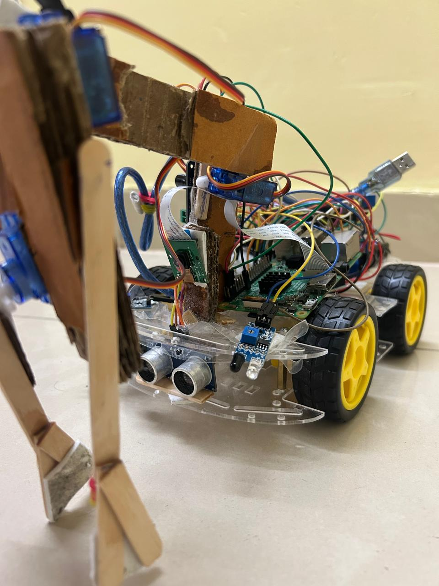
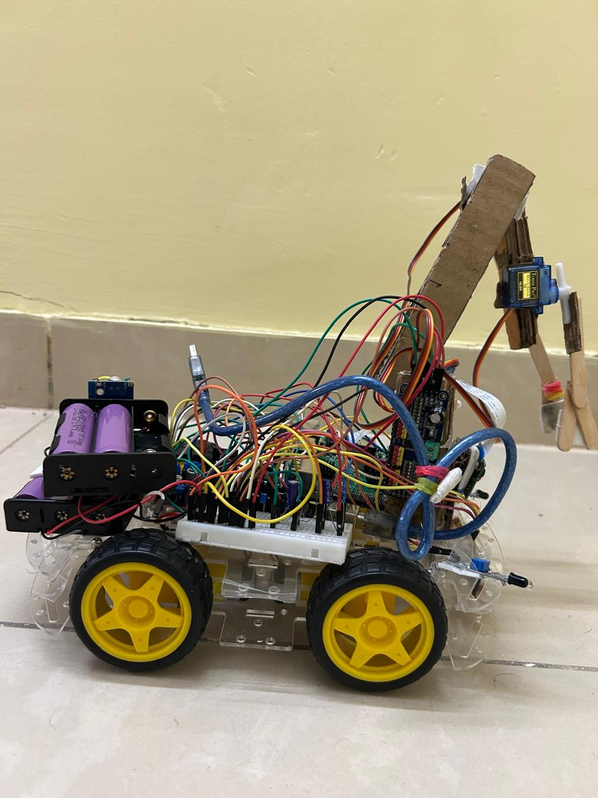

# Autonomous Plastic-Picking Robot

An AI-assisted autonomous robotic vehicle designed to detect, identify and collect plastic waste using computer vision, embedded systems, sensors and robotic manipulation.

**Project Status:** Prototype developed | Provisional patent filed

## Project Overview

Plastic pollution is a major environmental challenge. This project explores an automated approach to waste collection through an intelligent four-wheel robotic vehicle capable of identifying plastic waste and performing mechanical pickup.

The system integrates computer vision, embedded control, sensor-based navigation and a servo-operated robotic arm.

## System Architecture

The prototype uses a distributed control architecture:

- **Raspberry Pi 3B:** Image processing, plastic classification and robotic arm control.
- **Arduino Uno:** Motor control and low-level hardware operations.
- **Camera Module:** Captures images for plastic identification.
- **MobileNet:** Pretrained image classification model for plastic/non-plastic detection.
- **Sensors:** HC-SR04 ultrasonic and IR sensors for obstacle and object detection.
- **Actuation:** Servo motors and robotic gripper for object collection.
- **Motor Driver:** L298N for four-wheel locomotion.

## Key Features

- AI-assisted plastic waste identification.
- Four-wheel robotic vehicle.
- Sensor-based obstacle detection.
- Servo-controlled robotic arm and gripper.
- Integrated hardware and software architecture.
- Automated object pickup workflow.

## Technology Stack

| Category | Technologies |
|---|---|
| Programming | Python, C/C++ |
| Embedded Systems | Raspberry Pi, Arduino |
| Computer Vision | OpenCV, MobileNet |
| Sensors | Ultrasonic, IR |
| Actuation | Servo Motors, DC Motors |
| Motor Control | L298N, PWM |

## Prototype

### Front View

### Side View

## Testing and Challenges

The prototype was tested in controlled indoor environments.

Key observations:
- Plastic classification worked under stable lighting conditions.
- Glossy reflections affected detection performance.
- Servo reliability and arm load balancing required improvement.
- Continuous camera processing and motor operation affected battery life.

## Future Improvements

- Improve detection accuracy under different lighting conditions.
- Optimise robotic arm torque and mechanical stability.
- Improve battery management.
- Enhance navigation on uneven terrain.
- Expand the training dataset.

## Documentation

See [Project Case Study](docs/project-case-study.pdf) for the detailed project methodology, architecture, testing and evaluation.

## Project Information

**Project:** Automatic Plastic-Picking Truck  
**Institution:** Manipal Institute of Technology  
**Domain:** Robotics, Embedded Systems, Artificial Intelligence and Computer Vision  
**Patent:** Provisional patent filed

---

Developed as an interdisciplinary engineering project.
